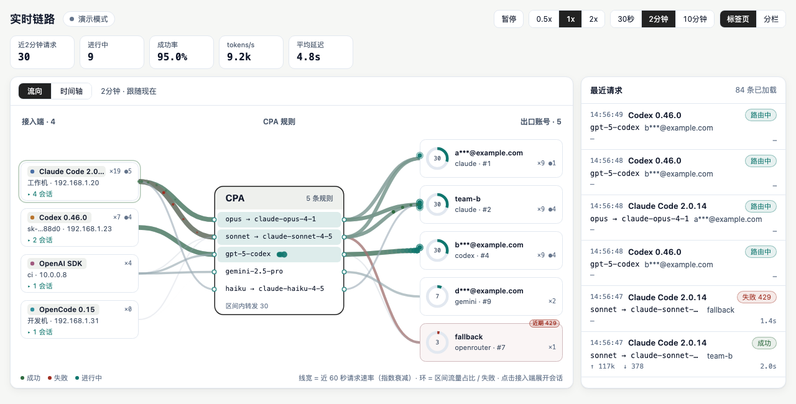
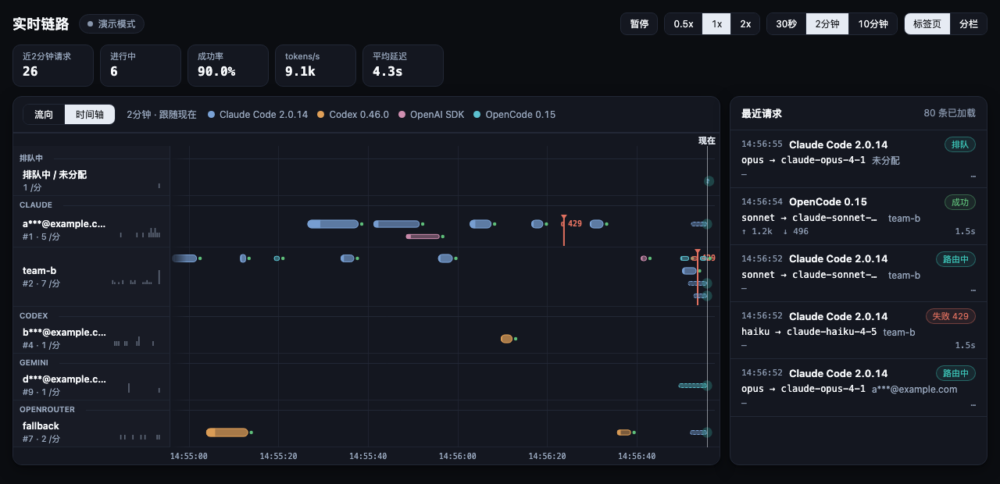

# Live Routes

[English](README.md) | [简体中文](README_CN.md)

Live Routes is a dynamic-library plugin for [CLIProxyAPI](https://github.com/router-for-me/CLIProxyAPI) (CPA) that adds a real-time routing dashboard. It shows every request flowing from a client (Claude Code, Codex, SDKs, ...) through the client API key and the routing rule to the upstream credential and model, including in-flight state, retries and 429 back-off, token usage, and session / sub-agent relationships. The page is served by CPA itself, needs no extra process, and keeps everything in memory.





## Requirements

- CLIProxyAPI v8 or later with dynamic-library plugin support (plugin schema 6). Tested with v8.0.29.
- One of: macOS 12+ arm64/amd64, Linux amd64/arm64, Windows amd64.
- Plugins are trusted code that CPA loads into its own process, and CPA disables them by default. Set `plugins.enabled: true` in the CPA config before you install.
- CPA management authentication must have a key configured before the dashboard can load data. Set `remote-management.secret-key` in CPA's `config.yaml`, or set `MANAGEMENT_PASSWORD` in CPA's environment. Without either, data requests return `403` (`remote management key not set`).
- The dashboard is not available in CPA Home mode, because Home mode disables plugin resource pages.

## Install

### 1. Enable plugins and the plugin

Add this to the CPA `config.yaml`:

```yaml
plugins:
  enabled: true
  dir: "plugins"          # relative to CPA's working directory; "~/..." is expanded
  configs:
    live-routes:
      enabled: true
      priority: -100      # run after other request interceptors
```

### 2. Install the library

**Plugin store.** If Live Routes is listed in a registry your CPA uses, install it from the plugin store in the management panel. `store/registry-entry.json` is the entry to submit to a registry.

**Release download (manual).** Download `live-routes_<version>_<goos>_<goarch>.zip` and `checksums.txt` from the [releases page](https://github.com/Roomen/cpa-live-routes/releases). Then put the library into `<plugins.dir>/<goos>/<goarch>/`. CPA also accepts it directly in `<plugins.dir>/`.

macOS / Linux:

```sh
VERSION=0.1.0; OS=darwin; ARCH=arm64          # linux/amd64, linux/arm64, darwin/amd64 ...
ZIP=live-routes_${VERSION}_${OS}_${ARCH}.zip
grep "$ZIP" checksums.txt | shasum -a 256 -c -  # or: sha256sum -c --ignore-missing checksums.txt
mkdir -p plugins/$OS/$ARCH
unzip -o "$ZIP" -d plugins/$OS/$ARCH           # live-routes.dylib (macOS) or live-routes.so (Linux)
xattr -d com.apple.quarantine plugins/$OS/$ARCH/live-routes.dylib 2>/dev/null || true   # macOS only
```

Windows (PowerShell):

```powershell
$zip = "live-routes_0.1.0_windows_amd64.zip"
(Get-FileHash $zip -Algorithm SHA256).Hash.ToLower()   # compare with checksums.txt
Expand-Archive $zip -DestinationPath plugins\windows\amd64 -Force   # live-routes.dll
```

**From source.** Run `make install-local PLUGINS_DIR=/path/to/plugins`. See [Build from source](#build-from-source).

### 3. Restart CPA and open the dashboard

After you restart CPA (or reload plugins from the management panel), the CPA log should show that the `live-routes` plugin was loaded. Open the dashboard in one of these ways:

- In a browser on the same machine: `http://127.0.0.1:<port>/v0/resource/plugins/live-routes/live` (8317 is the default port).
- From the CPA management panel or the EasyCLIProxyAPI plugin page, through the **Live Routes** menu entry.
- With `?demo=1` appended to the URL, for an offline demo with simulated traffic and no CPA data.

Send any request through CPA. It appears within a few seconds (the page polls every 1 s while requests are active, and backs off to 5 s when idle).

### Update and uninstall

To update, replace the library file and restart CPA. To uninstall, set `plugins.configs.live-routes.enabled: false`, or delete the library and restart. The plugin keeps no data, so there is nothing else to clean up.

## Using the dashboard

- **Flow view** shows what is happening now, in columns entry (OAuth / API credential) → CPA models (alias → model) → harness / client → session. The CPA header counts distinct upstream models among the visible rows. Requests travel right to left, from the session or client through CPA to the entry credential. Link width follows the request rate of the last 60 seconds. While a request is in flight its dot waits on the port where the link meets the CPA rule row or the entry card, and flies back when the request completes. Sessions are expanded by default (except for clients with more than 6 session rows); click a client to collapse or expand them. They stack to its right inside the client's own row band, so the links of other clients do not cross them. Sub-agent sessions are indented under their parent with tree lines, the parent card shows how many sub-agents it has, and beyond 4 the extra ones fold into one "+N sub-agents" row. Hover over a session for its full ID and its parent / child sessions. CPA does not report when a session closes, so the plugin infers it from idle time: a sub-agent idle for 90 seconds is treated as finished and removed; a root session with no request inside `active_window_minutes` is dimmed and labelled with its idle minutes, and removed after max(`active_window_minutes`, min(30 minutes, `retention_minutes`)) of idle time (a parent with an active sub-agent always stays), so sessions still in use show up as soon as the page opens. The plugin only sees requests that passed through CPA after it was loaded. Completions with no model and no credential (such as the `GET /v1/models` health checks that management GUIs send every 30 seconds) are not recorded.
- **Timeline view** is for looking back. It has one lane per entry credential; rows inside a lane are concurrent requests. Bars are coloured by upstream model, and the legend lists the models in view. A credential used recently (within the larger of the selected range and `active_window_minutes`) keeps its lane even when the range holds no request, labelled as idle with its last request time. Zoom levels are 30 s / 2 min / 10 min, and you can scroll or drag back to the oldest data still in memory. 429 responses are marked, and the tooltip shows `Retry-After`.
- **Top stats** cover the selected range: requests, in-flight, success rate (done / (done + failed)), output tok/s (output tokens ÷ actual generation time, the union of each request's first-token-to-end interval, idle time excluded) and average latency.
- **Controls:** pause, a temporary animation speed (0.5x / 1x / 2x), and the layout (tabs, or split with the flow strip above the entry lanes). These preferences are stored only in this browser. The page follows the system light/dark theme and honors `prefers-reduced-motion`.

## Troubleshooting

| Symptom | Cause / fix |
| --- | --- |
| Data returns `403 remote management key not set` | CPA has no management key configured. Set `remote-management.secret-key` in CPA's `config.yaml`, or set `MANAGEMENT_PASSWORD` in CPA's environment, then retry. |
| Data returns 401, or `403` says the IP is banned | Enter the configured CPA management key. Five failed key attempts from the same IP trigger a 30-minute ban; requests from that IP return 403 until the ban expires. Remote access also requires CPA remote management to be enabled. When the key stops working (401), the page drops the cached key and asks for it again. |
| No "queued / routing" state, client shows as unknown | `inflight_tracking` is `false`, so only completed requests (usage records) are shown. |
| Client IP is missing | CPA does not pass the client address to plugins. It is shown only behind a reverse proxy that sets `X-Forwarded-For` / `X-Real-IP`. |
| Data disappeared | CPA or the plugin restarted, or the data aged out of `retention_minutes` / `max_records`. Data is memory-only by design. |
| macOS refuses to load the library | Remove the quarantine attribute (see the `xattr` command above). |

## Configuration

All options live under `plugins.configs.live-routes`. The **配置** button on the page shows the values in effect and the matching YAML; the page is read-only, edit `config.yaml` and CPA pushes the change without a restart. Besides the options below, `enabled` and `priority` are handled by CPA itself. Use `priority: -100` so the observer runs after other interceptors.

| Key | Default | Range / values | Description |
| --- | --- | --- | --- |
| `retention_minutes` | `30` | 1 - 120 | How long finished requests are kept in memory. |
| `max_records` | `5000` | 1000 - 100000 | Record cap; the oldest records are evicted first. |
| `active_window_minutes` | `10` | 1 - 60 | Flow view: nodes with no request inside this window fade out; root sessions still in use stay dimmed with their path, see above. |
| `animation_speed` | `"1x"` | `0.5x`, `1x`, `2x` | Default animation speed of the page (viewers can change it). |
| `reduced_animation` | `false` | boolean | No flying dots, only link widths and counters. |
| `inflight_tracking` | `true` | boolean | Track queued and routed requests live. When `false` the plugin only replays usage records after completion. |
| `layout` | `"tabs"` | `tabs`, `split` | Default page layout: switchable views, or flow strip above entry lanes. |
| `api_key_labels` | `{}` | map | Friendly names for client API keys: sha256 hex prefix (at least 8 characters) of the key to a label. |

Compute a key prefix without exposing the key in a file:

```sh
printf %s "$KEY" | shasum -a 256 | cut -c1-8
```

```yaml
plugins:
  configs:
    live-routes:
      enabled: true
      priority: -100
      api_key_labels:
        "3f9a12bc": "alice laptop"
        "a1b2c3d4": "ci runner"
```

## Access model

The static page is served at `GET /v0/resource/plugins/live-routes/live` and carries no CPA data. Data endpoints are CPA management routes:

- `GET /v0/management/live-routes/snapshot`
- `GET /v0/management/live-routes/events`
- `GET /v0/management/live-routes/records`

Configure CPA management authentication with `remote-management.secret-key` in `config.yaml` or `MANAGEMENT_PASSWORD` in CPA's environment. If neither is set, data requests return `403 remote management key not set`. Every data request must send a valid CPA management key in a bearer `Authorization` header and pass CPA management authentication, including requests over loopback. By default the page keeps the entered key in this tab's `sessionStorage` (`lr-key`), so a reload does not ask again and closing the tab clears it. Ticking "在此浏览器记住密钥" (remember the key in this browser) also stores it in plain text in `localStorage` (`lr-key`), so new tabs and browser restarts do not ask again; use this only on a personal device. A 401/403 response or the 退出 (log out) button clears both copies. Scripts use the same bearer header. Access through a domain or reverse proxy also requires CPA remote management to be enabled.

For migration, the old resource data routes `/v0/resource/plugins/live-routes/api/{snapshot,events,records}` return 404, and legacy `require_key` is ignored.

Client API keys are redacted inside the plugin: only a mask such as `sk-...3f9a` and a short fingerprint are exposed, never the raw key. E-mail addresses in credential labels are masked.

## Performance

- With `inflight_tracking: true` the plugin declares a request interceptor. CPA calls it synchronously twice per request (before authentication, and after authentication for each attempt) and the host serializes the full request body for each call, roughly 1 - 2 ms per MB of body. The plugin itself returns a constant pass-through in microseconds.
- Set `inflight_tracking: false` for zero request-path overhead. You then get usage replay only: no queued / routed states and no user-agent based client detection.
- Usage handling and page polling cost are negligible. When nobody is viewing the page, the plugin does no background work.
- Use `priority: -100` so the observer runs after other interceptors.

## Storage guarantee

Memory only. The plugin writes nothing to disk, and all data is cleared when CPA or the plugin restarts. The page uses browser `localStorage` for UI preferences (`lr-view`, `lr-layout`, `lr-speed`, `lr-range`) and, when the viewer opts in to remembering it, the management key (`lr-key`).

`scripts/e2e/run.sh` verifies this against a real CPA process by comparing its open regular files with and without the plugin.

## Limitations

- The client IP is shown only when CPA sits behind a reverse proxy that sets `X-Forwarded-For` or `X-Real-IP`.
- The client user agent (and so the client kind) is known only with `inflight_tracking: true`.
- CPA Home mode disables plugin resource pages, so the dashboard is not available there.
- Data is bounded by `retention_minutes` and `max_records`; older history is gone by design.

## Build from source

Requires Go (see `go.mod`) and a C compiler, because plugins are built with `-buildmode=c-shared`.

```sh
make test                      # go vet + go test -race
make build                     # host platform -> bin/live-routes.<ext>
make darwin                    # macOS arm64 + amd64 (needs clang on macOS; builds a patched Go for amd64, see below)
make dist VERSION=0.1.0        # dist/live-routes_0.1.0_<goos>_<goarch>.zip + checksums.txt
make install-local PLUGINS_DIR=/path/to/plugins
make e2e                       # end-to-end test against a local CPA and a mock upstream
```

Linux and Windows builds need a native toolchain; release builds run on native GitHub Actions runners (`.github/workflows/release.yml`) for darwin arm64/amd64, linux amd64/arm64 and windows amd64. Pushing a tag `vX.Y.Z` builds all targets and publishes a release with the zips and `checksums.txt`, which is the layout the CPA plugin store installs from. `store/registry-entry.json` is the entry to submit to a plugin registry.

The darwin/amd64 library must be built with the toolchain from `scripts/darwin-amd64-go.sh`. Stock Go keeps the current goroutine in TLS slot 6 (`0x30(GS)`) on darwin/amd64 in every runtime, so a Go plugin loaded into the Go-built CPA overwrites the host's and CPA crashes; the patched toolchain moves the plugin's to slot 11 (`0x58(GS)`). `scripts/check-darwin.sh` rejects a library that touches slot 6 or targets a macOS newer than 12.0, and the release workflow loads the darwin/amd64 library into the official CPA build on a native Intel runner and runs the e2e suite before publishing.

The e2e script needs `node`, `python3`, `curl` and `lsof`, plus CPA sources next to this repository (override with `CPA_SRC`). It uses a mock upstream only and never touches `~/.cli-proxy-api`.

## License

MIT, see [LICENSE](LICENSE).
